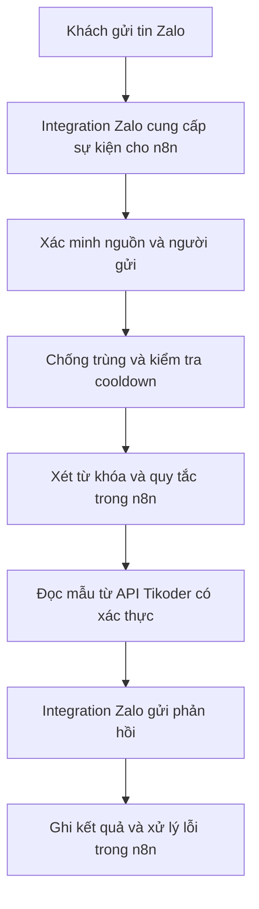

# Kiến trúc Tikoder - n8n - Zalo Auto Reply

> [!important] Quyết định của chủ ứng dụng
> **Tikoder chỉ lưu và cung cấp dữ liệu. n8n chịu trách nhiệm nhận sự kiện Zalo, xét quy tắc, điều phối và gửi phản hồi qua integration Zalo.** Không tiếp tục xây auto-reply dựa trên tracker hoặc cửa sổ Zalo do Tikoder điều khiển.

## 1. Mục tiêu

Khách gửi tin có từ khóa yêu cầu SĐT hoặc QR. n8n tự lấy đúng mẫu đã lưu trong Tikoder và gửi trả đúng hội thoại, không cần chủ shop duyệt từng tin.

Ví dụ:

- Khách gửi `sdt` hoặc `cho em xin số điện thoại`: trả nội dung SĐT đã lưu.
- Khách gửi `QR`: gửi ảnh QR đã lưu và chú thích nếu có cấu hình.
- Không tự tạo số điện thoại, thông tin thanh toán hoặc ảnh QR thay cho dữ liệu shop.

## 2. Luồng đích

Integration Zalo có thể là node hoặc dịch vụ đã có trong hệ thống. Chưa chốt tên, loại tài khoản hay nhà cung cấp khi chưa kiểm tra n8n thực tế. Webhook/HTTP Request thông thường không tự tạo ra khả năng nhận và gửi tin Zalo nếu chưa có nguồn sự kiện và kênh gửi tương ứng.

## 3. Phân chia trách nhiệm

| Thành phần | Trách nhiệm |
|---|---|
| Tikoder | Lưu mẫu SĐT, ảnh QR, chú thích và dữ liệu cấu hình liên quan |
| Tikoder | Cung cấp API đọc dữ liệu có xác thực, giới hạn đúng shop |
| n8n | Nhận sự kiện tin nhắn từ integration Zalo |
| n8n | Phân biệt tin khách với tin shop, xác định đúng hội thoại |
| n8n | Xét từ khóa, điều kiện phản hồi và cách xử lý tin khớp nhiều quy tắc |
| n8n | Chống trùng, cooldown và điều phối quá trình xử lý |
| n8n | Lấy dữ liệu cần thiết từ Tikoder rồi gọi integration Zalo gửi tin |
| n8n | Ghi kết quả, phân biệt lỗi và kết quả gửi chưa rõ |
| Integration Zalo | Cung cấp cơ chế nhận sự kiện và thực hiện gửi qua Zalo |

Tikoder có thể lưu dữ liệu cấu hình để n8n đọc, nhưng không thực thi quyết định auto-reply thay n8n.

### Tikoder không đảm nhiệm trong kiến trúc đích

- Không quét DOM Zalo để phát hiện tin khách.
- Không dùng Playwright/tracker trong app làm nền tảng cho auto-reply.
- Không yêu cầu mở cửa sổ Zalo do Tikoder quản lý để auto-reply hoạt động.
- Không tự điền ô chat, nhấn Enter hoặc upload ảnh vào giao diện Zalo.
- Không yêu cầu n8n gọi lại API app để app trực tiếp gửi tin.
- Không duyệt thủ công từng tin đã khớp quy tắc.

Phạm vi này áp dụng cho auto-reply SĐT/QR. Không tự ý thay đổi đường gửi báo giá đang có.

## 4. Nguyên tắc API dữ liệu

Đây là yêu cầu thiết kế, chưa phải API đã được triển khai/nghiệm thu:

- n8n đọc mẫu qua API có xác thực dành cho tích hợp, không dựa vào cookie đăng nhập giao diện của chủ shop.
- Xác thực và phân quyền đúng shop; không nhận tenant tùy ý mà bỏ qua kiểm tra quyền.
- Chỉ trả các trường cần cho tác vụ: mẫu text hoặc ảnh QR và chú thích tương ứng.
- Ảnh QR được cung cấp qua cơ chế truy cập được bảo vệ, phù hợp với khả năng upload của integration Zalo. Không tự biến ảnh riêng tư thành URL công khai.
- Không hardcode secret vào workflow export hoặc mã frontend.
- Chưa chốt URL/định dạng endpoint trước khi kiểm tra integration hiện có.

## 5. Quy tắc vận hành

- Một tin nguồn không tạo nhiều phản hồi do webhook lặp hoặc execution retry.
- Cooldown được áp dụng theo phạm vi người gửi/quy tắc đã chốt; không dùng nó để che lỗi mất tin.
- Không tự phản hồi tin do chính shop gửi hoặc tin lịch sử không thuộc phạm vi xử lý.
- Không tự gửi lại khi kết quả thao tác gửi còn mơ hồ. Chỉ retry khi có bằng chứng an toàn hoặc cơ chế idempotency của integration.
- Kết quả chưa rõ của một event không khóa vô thời hạn tất cả yêu cầu mới.
- Khi không có mẫu, ảnh hoặc cấu hình hợp lệ, báo lỗi rõ ràng thay vì gửi dữ liệu tự bịa.
- Hạn chế lưu nội dung khách, SĐT và thông tin xác thực trong log/execution; không chia sẻ execution chứa secret.

## 6. Các giới hạn đã chốt

> [!warning] Workflow báo giá được bảo vệ
> **Không sửa, thay thế, deactivate hoặc chạy thử workflow báo giá `jzJwwSTD9yUgEgPr` để sửa auto-reply.** Luồng auto-reply được tách riêng.

- Ưu tiên kiểm tra và dùng lại integration Zalo đã có bên n8n.
- Không mặc định cần cài package/node/dịch vụ mới. Nếu thực sự thiếu khả năng nhận hoặc gửi, trình bày lựa chọn và xin duyệt trước khi bổ sung.
- Không đổi mẫu SĐT, QR, credentials, tài khoản hoặc allowlist khi chưa được yêu cầu.
- Không tự gỡ mã cũ vì có thể ảnh hưởng báo giá. Chỉ lập kế hoạch tách/tắt phần auto-reply cũ sau khi kiểm tra phụ thuộc và được duyệt.

## 7. Hiện trạng đã kiểm tra trong repo

Các kết luận dưới đây dựa trên mã trong repo, không xác nhận trạng thái n8n đang chạy:

1. File `zalo-auto-reply.workflow.json` đang dùng luồng `Webhook -> Inspect -> IF -> Send Signed Command -> Respond`.
2. Hai HTTP node gọi về Tikoder tại `/api/integrations/n8n/zalo-auto-reply/inspect` và `/api/integrations/n8n/zalo-auto-reply/send`.
3. Service Tikoder hiện gọi adapter gửi text/ảnh. Vì vậy bản triển khai cũ vẫn để app nhận, xét và gửi tin, chưa đúng kiến trúc chốt ở note này.
4. API giao diện lấy cấu hình/ảnh hiện phụ thuộc session đăng nhập; cần đánh giá API đọc dành riêng cho tích hợp.
5. Bản workflow trong repo chưa có node nhận tin từ Zalo hoặc node trực tiếp gửi Zalo.
6. Chưa kiểm tra được danh sách node/integration cài trong n8n thực tế. Không suy ra rằng chưa có integration chỉ vì repo không chứa nó.

> [!note] Thay thế định hướng cũ
> Note này là nguồn quyết định kiến trúc cho các bước tiếp theo. Các tài liệu trước về DOM tracker, baseline, browser automation và callback yêu cầu app gửi tin chỉ ghi lại hướng triển khai cũ, không phải kiến trúc đích được chủ ứng dụng chọn.

## 8. Bước tiếp theo

- [ ] Kiểm tra workflow và integration Zalo hiện có trong n8n bằng quyền đọc hoặc bản export đã bỏ dữ liệu nhạy cảm.
- [ ] Xác định integration hỗ trợ nhận sự kiện và gửi text/ảnh như thế nào, dùng loại tài khoản nào và giới hạn gì.
- [ ] Nếu chưa có integration, xác định phần thiếu và đề xuất phương án; không tự cài thêm.
- [ ] Chốt hợp đồng API Tikoder chỉ cung cấp dữ liệu, cơ chế xác thực và phân quyền shop.
- [ ] Xây workflow auto-reply riêng: nhận tin -> xét quy tắc/chống trùng -> đọc dữ liệu -> gửi Zalo -> ghi kết quả.
- [ ] Kiểm thử gửi thật trên liên hệ thử được cho phép.
- [ ] Sau khi luồng mới đạt, trình duyệt kế hoạch tắt/tách phần auto-reply cũ trong Tikoder, không ảnh hưởng báo giá.

## 9. Điều kiện nghiệm thu

Không coi trạng thái monitoring, HTTP 200/202, execution xanh hoặc test offline là bằng chứng khách đã nhận tin.

- [ ] Tài khoản thử gửi một tin `sdt`; nhận đúng mẫu SĐT đã lưu, đúng một lần.
- [ ] Sau cooldown, gửi yêu cầu mới; nhận phản hồi lần hai mà không duyệt thủ công tin trước.
- [ ] Event/callback lặp không tạo tin gửi trùng.
- [ ] QR được kiểm tra riêng khi đã có ảnh và quy tắc bật; nhận đúng ảnh đã lưu trong đúng hội thoại.
- [ ] Auto-reply không phụ thuộc cửa sổ/tracker Zalo trong Tikoder.
- [ ] Có thể truy vết cùng một yêu cầu từ sự kiện Zalo tới execution n8n, API dữ liệu và kết quả gửi.
- [ ] Workflow báo giá `jzJwwSTD9yUgEgPr` giữ nguyên.

**Trạng thái: kiến trúc đã được chủ ứng dụng xác nhận; chưa xác nhận hoàn thành triển khai hoặc gửi đầu cuối.**
